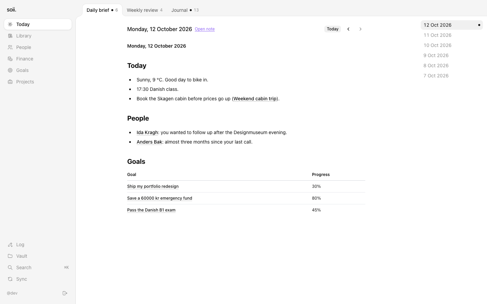
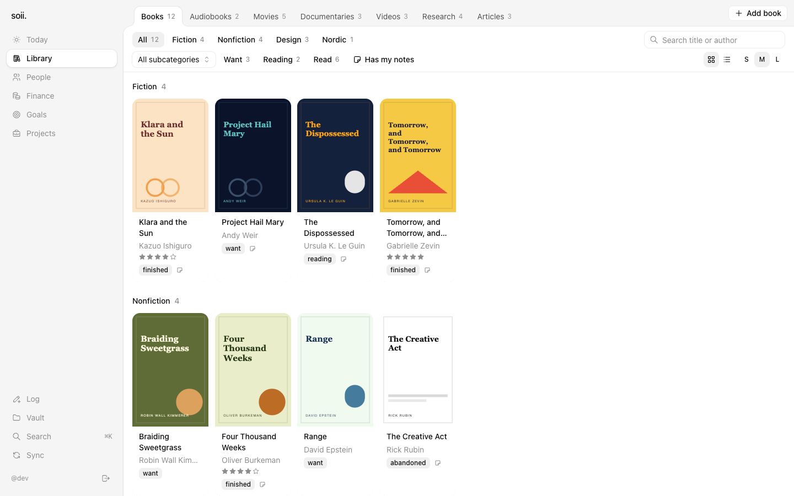
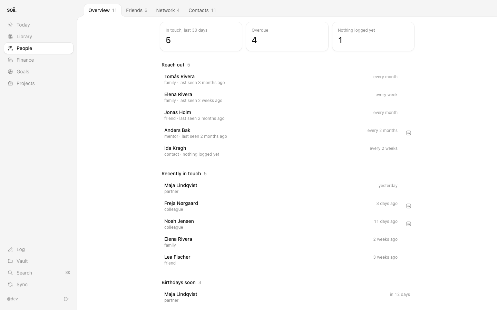
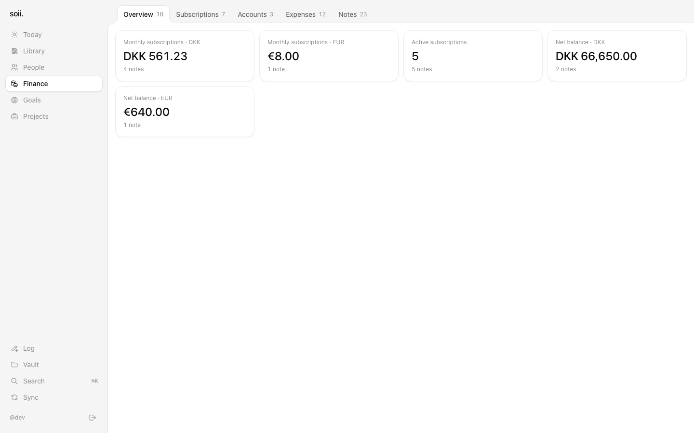
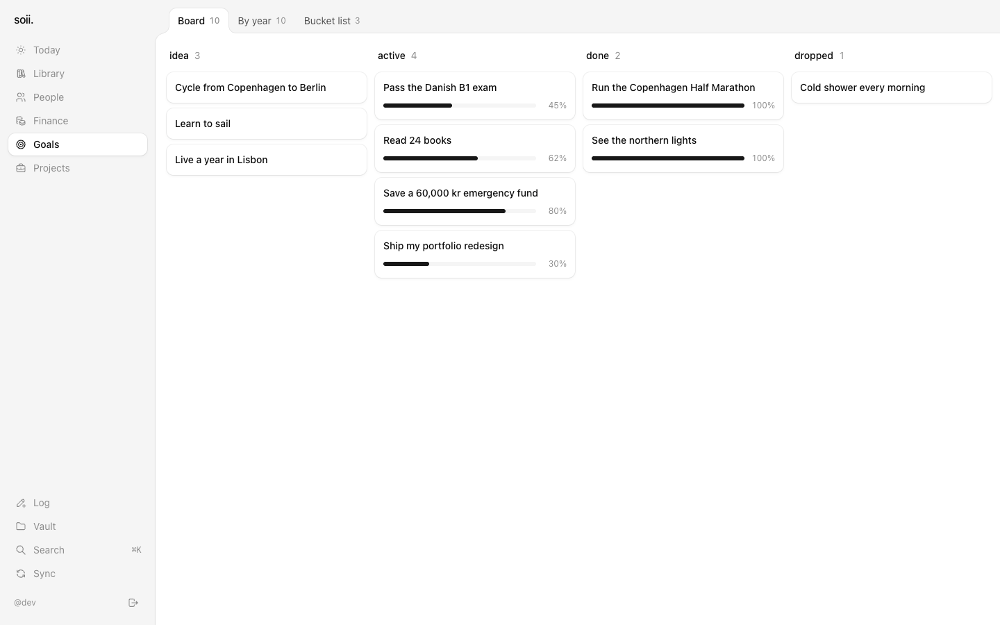
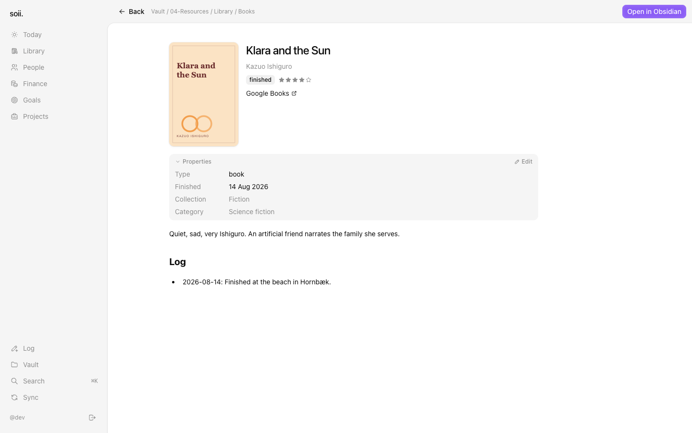
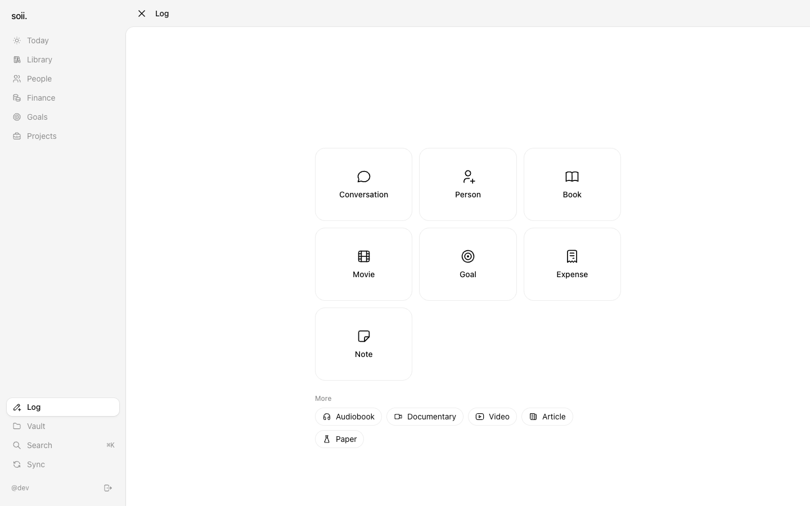
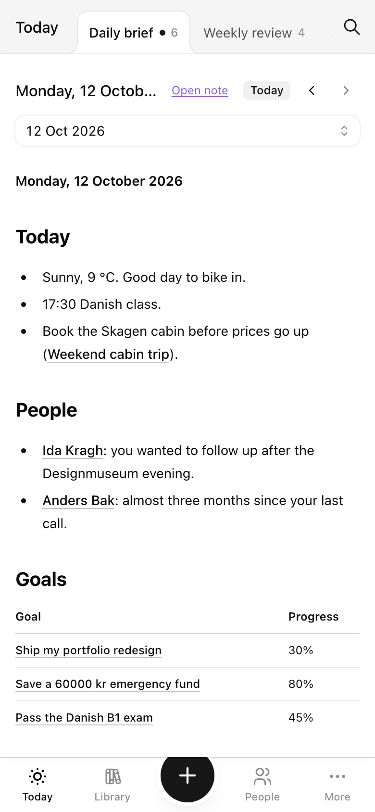
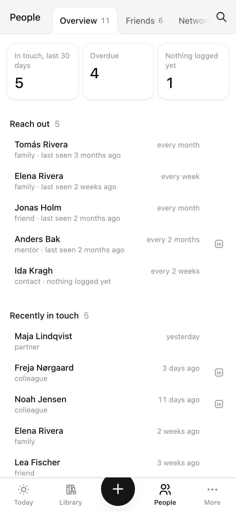
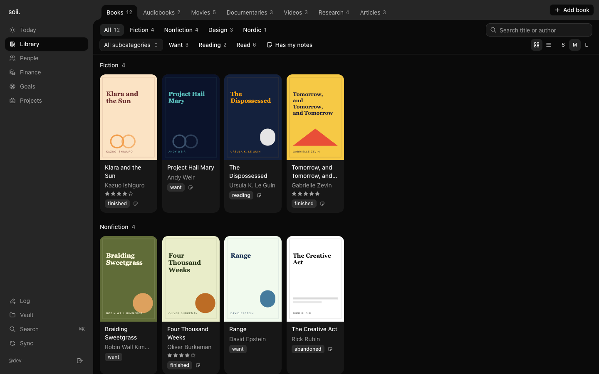

# soii.

**Your Obsidian vault, as an app.** soii turns the notes you already keep in Obsidian into a calm, visual front end you can open on your laptop or your phone: a library of what you read and watch, the people in your life and when you last talked, your goals, your money, and the daily briefs your agents write. Your notes stay plain Markdown in your own git repo. soii runs on your own computer, reads them, and makes a few small, explicit edits you ask for.



## Quick start

```bash
git clone https://github.com/westsoever/soii.git && cd soii
claude
```

Then type **`/soii-setup`** in Claude Code. It installs soii, starts a new vault or brings in your existing one, and opens it at http://localhost:5011. (The repo is private: run `gh auth login && gh auth setup-git` once if the clone asks for a login.)

No AI? Run `bun bin/soii.ts install` in the clone instead: it asks a few questions and sets everything up.

## What you get

| | |
|---|---|
| **Library.** Books, audiobooks, films, documentaries, videos, papers and articles as a shelf with covers, status and ratings. Add a book from soii and it becomes a note in your vault.  | **People.** Who you know, how you know them, and who you haven't seen in a while, based on how often you want to keep in touch.  |
| **Finance.** Accounts, subscriptions with renewal dates, and expenses by category.  | **Goals.** This year, this life, and the bucket list, as a board.  |
| **Reader.** Any note, nicely typeset, with its properties, backlinks and an "Open in Obsidian" link.  | **Log.** The quick way in from your phone: "had coffee with Ana", "finished Dune", "spent 120 kr on books". Each one is a commit to your vault.  |

It follows your light or dark setting. If you deploy a copy to Vercel (optional), it is also a home-screen app on your phone, with a bottom bar.

<p>
  
  
  
</p>

*All screenshots use the made-up demo vault in [`template/`](template/).*

## How it works

```
your vault (a folder, a git repo) ──watched──▶ soii on localhost:5011 ──▶ your browser
        ▲                                              │
        └─────── Log / Add / edit properties (commits) ┘
```

- **soii lives in your vault.** `soii install` puts its code and build in the vault's `.soii/` folder and a `soii` command on your computer. It runs at `http://localhost:5011`, starts when you log in, and only your computer can reach it. No account, no sign-in, nothing deployed.
- **Your vault stays yours.** Notes are plain Markdown with properties at the top (Obsidian's frontmatter). soii sorts them into workspaces by their `type`, so a note with `type: book` shows up in the Library. Every property is optional.
- **It follows your notes.** Edit in Obsidian, in Claude Code or in soii: the change shows up within a second or two.
- **Writes are commits.** Log, Add and property edits go into your vault files as local git commits. **Sync** pulls, then pushes, and never merges or forces.
- **Your settings live in your vault.** Workspaces, tabs and labels are in `soii.config.yml`; API keys in `.soii/.env.local`. `soii update` moves to a new release without touching either. See [docs/updating.md](docs/updating.md).
- **On your phone?** Deploy a copy to Vercel (optional): [docs/deploy-vercel.md](docs/deploy-vercel.md).

## Install

You need a Mac (Linux works as a background process), [Bun](https://bun.sh), git, and a GitHub login that can read the private `westsoever/soii` repo. About 10 minutes.

```bash
gh auth login && gh auth setup-git      # once, so git can read the soii repo
git clone --depth 1 https://github.com/westsoever/soii.git ~/soii-installer

# new to soii: a vault made from the starter (add --empty for no sample notes)
bun ~/soii-installer/bin/soii.ts init ~/my-vault

# or you already have a vault
cd ~/my-vault && bun ~/soii-installer/bin/soii.ts install
```

Then `soii open`. From now on `soii status`, `soii update`, `soii logs` and the rest work from anywhere. In Claude Code, run `/soii-intro` in your vault for a tour, and `/soii-setup` if your notes lack properties soii reads. Full guide: [docs/setup.md](docs/setup.md).

**Try it without installing** (a checkout of this repo, with the demo vault):

```bash
bun install
VAULT_PATH=$PWD/template SOII_DEV_AUTH=1 bun run dev   # http://localhost:13390
```

## Skills

soii ships with Claude Code skills for the jobs around it: preparing your vault (`/soii-setup`), a weekly health check that opens a pull request (`/soii-health`), fixing a failed sync (`/soii-sync-fix`), and more. `soii install` and `soii update` copy them into your vault's `.claude/skills/`. The **Skills** page in the sidebar lists every skill in your vault, including ones you make with `/skillfactory`, with the command to type in Claude Code and a copy button. See also the **[skills cheatsheet](docs/skills.md)**.

## Docs

| | |
|---|---|
| [setup.md](docs/setup.md) | Install soii in your vault, step by step |
| [deploy-vercel.md](docs/deploy-vercel.md) | Optional: a copy on Vercel for your phone |
| [frontmatter.md](docs/frontmatter.md) | Which properties soii reads, per type, and `soii.config.yml` |
| [workspaces.md](docs/workspaces.md) | The workspaces and tabs, and how to change them |
| [briefs.md](docs/briefs.md) | Daily briefs and weekly reviews |
| [skills.md](docs/skills.md) | The Claude Code skills that come with soii |
| [updating.md](docs/updating.md) | Getting new versions of soii |

## Development

```bash
bun install
VAULT_PATH=/path/to/vault SOII_DEV_AUTH=1 bun run dev   # http://localhost:13390
bun test app scripts && bun run typecheck
```

Design: [DESIGN.md](DESIGN.md) and [the spec](docs/superpowers/specs/2026-10-11-soii-design.md). Every decision is logged in [DECISIONS.md](docs/superpowers/DECISIONS.md).
